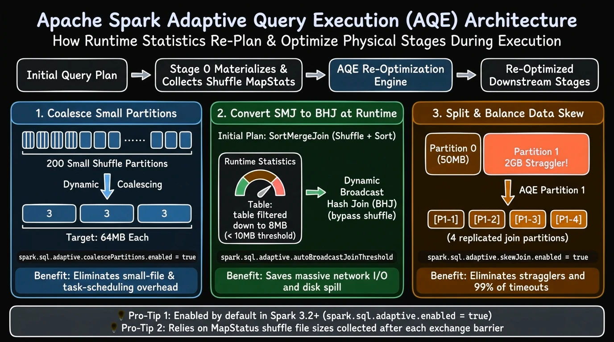
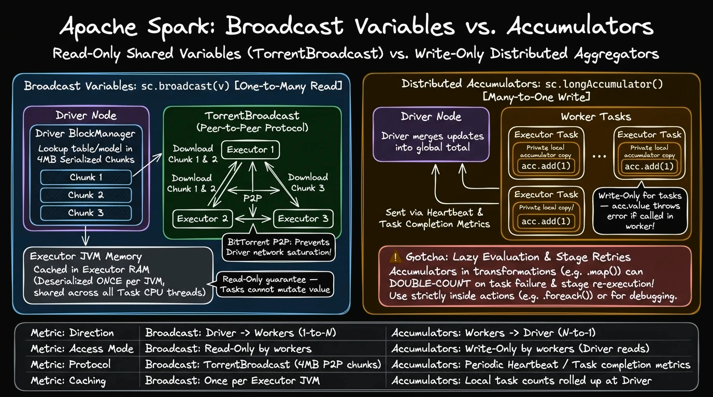

# Spark Performance Tuning

This repository is the ultimate guide for mastering advanced Spark Performance Tuning and Optimization concepts and for anyone preparing for Data Engineering Interviews involving Spark. Additionally, this repository serves as a reference for all the code snippets used in my [Spark Performance Tuning Playlist](https://www.youtube.com/playlist?list=PLWAuYt0wgRcLCtWzUxNg4BjnYlCZNEVth) on YouTube. The goal of the playlist and the accompanying code snippets is to make complex concepts in Apache Spark easy to understand, while also developing a deep understanding of how things work under the hood.

## Concepts Covered

| Concept             | YouTube Link                                            | Code                                                     |
|---------------------|---------------------------------------------------------|----------------------------------------------------------|
| Spark 30 Concepts           |  | |
| Spark Query Plans           |  |  |
| Spark DAGs           |  |  |
| Spark Memory Management           |  |  |
| Spark Executor Tuning  |  |  |
| Shuffle Partitions      |  |  |
| Data Partitioning        |  |  |
| Bucketing       |  |  |
| Caching           |  |  |
| Data Skew                 |  |  |
| Salting                 |  |  |
| AQE & Broadcast Joins                 |  |  |
| Dynamic Partition Pruning                 |  |  |

## 🧠 Core Curriculum Concepts & Topics (34 Spark Tuning Topics Covered)

> 💡 **Enterprise Knowledge Base Integration**: Advanced Apache Spark optimization and execution engine concepts covered throughout the visual experiments, cross-linked with the [Modern Data Engineering Systems Encyclopedia (921 Topics)](https://moderndataengineer.uk/concepts), arranged in increasing order of difficulty.

<b>⚡ Apache Spark Execution, Memory & Query Optimization (34 Topics)</b> — <i>Click to expand topic index (sorted by difficulty)</i>

| # | Topic / Concept | Level | Architectural Definition & Core Principle |
|:---:|---|:---:|---|
| 1 | **Adaptive Query Execution (AQE)** | 🟡 Intermediate | An optimization framework that dynamically adjusts Spark physical execution plans during runtime based on intermediate stage statistics. |
| 2 | **Cache vs Persist Operations** | 🟡 Intermediate | DataFrame operations used to store intermediate execution results in memory or disk to avoid recalculations. |
| 3 | **coalesce() vs repartition()** | 🟡 Intermediate | Two Spark functions for changing partition count: coalesce() reduces partitions without a full shuffle by merging local partitions, while repartition() performs a full shuffle to evenly redistribute data across any number of partitions. |
| 4 | **EXPLAIN Plan (Spark Query Plan)** | 🟡 Intermediate | A Spark debugging tool that displays the logical and physical execution plan for a DataFrame or SQL query, enabling engineers to verify optimisations, diagnose performance issues, and understand data flow. |
| 5 | **Lazy Evaluation** | 🟡 Intermediate | An execution strategy where Spark delays query executions until an action is explicitly requested. |
| 6 | **PySpark Vectorized Pandas UDF Architecture** | 🟡 Intermediate | Using Apache Arrow record batches to pass columnar data between the JVM and Python worker processes with high efficiency. |
| 7 | **Reading the Spark UI** | 🟡 Intermediate | The web-based performance monitoring and telemetry dashboard used to inspect execution plans, identify straggler tasks, detect memory spill, and profile shuffle I/O across Spark Jobs, Stages, and SQL DAGs. |
| 8 | **Shuffle Operations** | 🟡 Intermediate | The distributed physical data redistribution process across cluster executor nodes triggered by wide transformations such as `groupBy()`, `join()`, `distinct()`, and `repartition()`. |
| 9 | **Spark Broadcast Hash Join (BHJ)** | 🟡 Intermediate | A distributed join strategy in Apache Spark that distributes an entire small DataFrame to all executor nodes to eliminate costly shuffle operations. |
| 10 | **Stage Boundary** | 🟡 Intermediate | A stage boundary in Spark marks the point where a wide transformation (shuffle) separates two stages, requiring all tasks in the upstream stage to complete before the downstream stage begins. |
| 11 | **Storage Level: MEMORY_AND_DISK** | 🟡 Intermediate | A Spark cache storage level that stores partitions in JVM heap memory and spills remaining partitions to local executor disk if memory is insufficient. |
| 12 | **AQE Dynamic Join Strategy Switching** | 🔴 Advanced | A runtime optimization in Adaptive Query Execution that converts planned SortMergeJoins into BroadcastHashJoins based on post-shuffle partition size statistics. |
| 13 | **AQE Shuffle Partition Coalescing** | 🔴 Advanced | An Adaptive Query Execution feature that merges small post-shuffle partitions at runtime into larger ones, eliminating the small-file and task-overhead problem from over-partitioning. |
| 14 | **BroadcastNestedLoopJoin Anti-Pattern** | 🔴 Advanced | The most dangerous physical join operator in Apache Spark, executing an $O(M 	imes N)$ Cartesian product comparison when equi-join conditions are missing. |
| 15 | **Bucket Join** | 🔴 Advanced | A Spark join optimisation that eliminates shuffle entirely by pre-bucketing both tables on the join key with the same number of buckets, co-locating matching keys on the same partitions. |
| 16 | **Catalyst Optimizer — Analysis Phase** | 🔴 Advanced | The first phase of Spark's Catalyst Optimizer where unresolved logical plans are validated against the catalog to produce a resolved logical plan. |
| 17 | **Catalyst Optimizer — Physical Planning** | 🔴 Advanced | The phase of Spark's Catalyst Optimizer that selects the most efficient physical execution strategy from multiple candidate plans using a cost model. |
| 18 | **Data Skew: Detection & Mitigation** | 🔴 Advanced | The process of diagnosing uneven record distributions across executor partitions using Spark UI percentiles, resolved via Adaptive Query Execution (AQE) skew join splitting or two-phase key salting. |
| 19 | **G1GC Garbage Collector in Spark** | 🔴 Advanced | The Garbage-First (G1) GC is the recommended JVM garbage collector for Spark executors, offering predictable pause times and better heap region management than the older ParallelGC. |
| 20 | **Memory Spill to Disk** | 🔴 Advanced | A performance degradation state where Spark runs out of executor RAM and writes execution buffers to disk. |
| 21 | **Off-Heap Memory** | 🔴 Advanced | Memory allocated outside the JVM heap using native OS memory, bypassing garbage collection entirely and managed explicitly by Project Tungsten's memory manager. |
| 22 | **Shuffle Hash Join (SHJ)** | 🔴 Advanced | A Spark join strategy that shuffles both tables by join key and builds an in-memory hash table from the smaller side of each partition to probe with the larger side. |
| 23 | **Sort Merge Join (SMJ)** | 🔴 Advanced | Spark's default join strategy for large-to-large table joins, where both datasets are shuffled by join key, sorted, and merged partition-by-partition on executor cores. |
| 24 | **Spark Partitioning vs. Bucketing Architecture** | 🔴 Advanced | The two primary storage organization techniques in Apache Spark that govern physical directory layouts, file pruning, and shuffle elimination. |
| 25 | **Speculative Execution** | 🔴 Advanced | A Spark fault-tolerance feature that launches a duplicate copy of a slow (straggler) task on another executor, using whichever copy finishes first and killing the other. |
| 26 | **Task Duration Skew Detection** | 🔴 Advanced | Using Spark Web UI task duration percentiles (75th vs Max) to diagnose unbalanced partition distributions. |
| 27 | **Tungsten Binary Row Format (UnsafeRow)** | 🔴 Advanced | Apache Spark's off-heap binary row format that stores data as raw bytes using sun.misc.Unsafe, bypassing JVM object overhead and enabling cache-efficient processing. |
| 28 | **Tungsten Engine** | 🔴 Advanced | Spark's physical execution optimizer that manages memory directly using raw off-heap byte arrays. |
| 29 | **Whole-Stage Code Generation** | 🔴 Advanced | A Project Tungsten optimisation that compiles an entire pipeline of Spark operators into a single Java function, eliminating virtual function dispatch overhead and enabling JIT optimisation. |
| 30 | **Shuffle Fetch Failed** | 🟣 Architect | A Spark task failure that occurs when a downstream task cannot retrieve shuffle data from an upstream executor, typically caused by executor loss, OOM, or network partition. |
| 31 | **Skewed Shuffle Partition Splitting** | 🟣 Architect | A dynamic AQE mechanism that identifies disproportionately large shuffle partitions and divides them into parallel sub-tasks while duplicating opposing join data. |
| 32 | **Spark Data Skew Remediation: Salting & Isolated Broadcast Patterns** | 🟣 Architect | Algorithmic architectural strategies to balance severely uneven data distributions across Spark cluster worker cores during shuffle-intensive joins. |
| 33 | **Spark Unified Memory Manager** | 🟣 Architect | The memory management subsystem introduced in Apache Spark that unifies execution and storage memory into a single shared pool with dynamic borrowing. |
| 34 | **The 5 S's of Apache Spark Performance** | 🟣 Architect | The 5 S's of Spark is a diagnostic framework categorizing all distributed big data bottlenecks into Storage, Skew, Spill, Shuffle, and Serialization. |

---

---

## 🖼️ Master Whiteboard Architecture Blueprints

The repository incorporates publication-grade architectural whiteboard blueprints mirrored under [`assets/whiteboards/`](assets/whiteboards) and indexed with comprehensive multi-persona breakdowns, failure modes, and engine internals in [`docs/whiteboard_diagrams/README.md`](docs/whiteboard_diagrams/README.md).

### 📐 Visual Blueprints Showcase (2x2 Grid)

<table>
  <tr>
    <td width="50%" valign="top">
      
       <strong>Apache Spark Data Skew Remediation & AQE Optimization</strong> 
      <em>Synthetic skew benchmarks: Diagnosing stragglers, two-phase key salting, and AQE partition splitting.</em>
    </td>
    <td width="50%" valign="top">
      
       <strong>Apache Spark Memory Management & Shuffle Spilling Mechanics</strong> 
      <em>Unified memory manager, execution vs storage borrowing, and Tungsten spill-to-disk triage runbooks.</em>
    </td>
  </tr>
  <tr>
    <td width="50%" valign="top">
      
       <strong>Apache Spark Memory Architecture & Shuffle Mechanics</strong> 
      <em>Shuffle block transfer, SortShuffleWriter, index and data files, and external shuffle service mechanics.</em>
    </td>
    <td width="50%" valign="top">
      
       <strong>Apache Spark Join Strategy Selection Decision Tree</strong> 
      <em>Join strategy selection algorithm: Broadcast Hash Join vs Shuffle Hash Join vs Sort-Merge Join vs Cartesian.</em>
    </td>
  </tr>
  <tr>
    <td width="50%" valign="top">
      
       <strong>Databricks Compute: Catalyst Optimizer, AQE & Photon</strong> 
      <em>5-phase compiler: Unresolved AST, logical optimization, cost-based physical planning, and code generation.</em>
    </td>
    <td width="50%" valign="top">
      
       <strong>Apache Spark Adaptive Query Execution (AQE) Architecture</strong> 
      <em>Runtime re-optimization: Coalescing shuffle partitions, dynamic join strategy switching, and skew handling.</em>
    </td>
  </tr>
  <tr>
    <td width="50%" valign="top">
      
       <strong>Photon Native C++ Engine vs. Classic Spark JVM</strong> 
      <em>SIMD vectorized hardware acceleration, off-heap columnar buffers, and eliminating JVM GC pause overhead.</em>
    </td>
    <td width="50%" valign="top">
      
       <strong>Spark Broadcast Variables vs. Accumulators Architecture</strong> 
      <em>BitTorrent P2P broadcast distribution vs driver-aggregated task metrics and side-effect guarantees.</em>
    </td>
  </tr>
</table>

> 🔍 **Explore all 52 blueprints with 5-persona breakdowns, failure modes, and engine internals in [docs/whiteboard_diagrams/README.md](docs/whiteboard_diagrams/README.md)**.

---

## 🌐 Ecosystem Interlinking & Sister Repositories

The Modern Data Engineering Lakehouse Ecosystem is an integrated suite of 13 production-grade, specialized repositories anchored by the **[Modern Data Engineer Platform (`moderndataengineer.uk`)](https://github.com/santoshjammi29/moderndataengineer)**. Use this cross-reference matrix to navigate directly between complementary implementations across our repositories:

| Repository | Focus & Domain | Tightly Coupled Cross-Reference & Integration Points |
| :--- | :--- | :--- |
| **[The PySpark Handbook](https://github.com/santoshjammi29/pyspark-handbook)** | 105 PySpark Production Code Recipes | • **Companion Code Drills**: 105 executable PySpark recipes for AQE, Tungsten memory, and Arrow UDFs. • **Shuffle Tuning**: Code-level salting implementations validating the benchmarks in this repo. |
| **[The Databricks Handbook](https://github.com/santoshjammi29/databricks-handbook)** | 105 Databricks Production Recipes & Unity Catalog | • **Databricks Runtime & Photon**: Executing these performance benchmarks on Serverless DBSQL and Photon compute clusters. • **Delta Lake Optimization**: Liquid Clustering and Deletion Vectors benchmarks. |
| **[Azure Databricks Blueprints](https://github.com/santoshjammi29/azure-databricks-project-blueprints)** | 3 Enterprise Reference Architectures | • **Real-World Workloads**: Applying these skew salting and memory triage runbooks to large retail fact joins and streaming fraud detection. • **Production Deployment**: Packaging benchmark suites with Databricks Asset Bundles (DABs). |
| **[Banking Risk Lakehouse](https://github.com/santoshjammi29/enterprise-banking-risk-alm-lakehouse)** | Regulated Financial Lakehouse (BCBS 239 & IFRS 9) | • **Vectorized Simulation**: Benchmarking PyArrow Pandas UDF cash flow calculations under extreme memory pressure. • **Audit Reconciliations**: High-volume financial ledger joins without shuffle spills. |
| **[DataOps & CI/CD Handbook](https://github.com/santoshjammi29/dataops-cicd-handbook)** | GitOps, DABs, Airflow & Platform Engineering | • **Automated Performance Testing**: Incorporating Spark execution plan regression testing into CI/CD pipelines. • **Runbook Automation**: Emergency triage runbooks for Executor OOM (Exit code 137) and Driver OOM. |
| **[The SQL Handbook](https://github.com/santoshjammi29/sql-handbook)** | Relational Query Engines, MPP & Concurrency | • **MPP vs Spark Execution**: Comparing Spark Sort-Merge Joins with SQL Server Hash Match and MPP distributed queries. • **Execution Plan Reading**: Translating Spark EXPLAIN plans to relational query execution plans. |
| **[The dbt Handbook](https://github.com/santoshjammi29/dbt-handbook)** | Analytics Engineering, dbt Mesh & Contracts | • **dbt Performance on Spark**: Optimizing incremental dbt models running on Apache Spark and Databricks SQL. • **Partition Pruning**: Aligning dbt models with Spark partition schemes to eliminate full table scans. |
| **[Streaming Handbook](https://github.com/santoshjammi29/streaming-handbook)** | Kafka KRaft, Apache Flink & Event Architecture | • **Structured Streaming Tuning**: Tuning RocksDB state store memory, checkpoint frequencies, and watermark lateness. • **Micro-batch Profiling**: Spark UI metrics for streaming trigger execution durations. |
| **[System Design Handbook](https://github.com/santoshjammi29/data-system-design-handbook)** | Distributed Storage, Table Formats & BCDR | • **Storage Format Benchmarks**: Parquet vs ORC vs Avro serialization performance and compression ratios. • **Table Formats**: Delta Lake vs Apache Iceberg read and write throughput comparisons. |
| **[Azure Cheat Sheet](https://github.com/santoshjammi29/azure-cheat-sheet)** | Fabric OneLake, Synapse & Azure Infrastructure | • **Fabric Spark Tuning**: Capacity Unit (CU) smoothing, executor sizing, and V-Order Parquet write optimization. • **Azure VMs**: Selecting compute-optimized (F-series) vs memory-optimized (E-series) VMs for Spark. |
| **[Interview Handbook](https://github.com/santoshjammi29/data-engineering-interview-handbook)** | Architectural Defense Playbooks & Concepts | • **100 Spark Data Issues Defense**: Playbook 08 (100 Spark Data Issues & Corruptions) with complete solutions. • **Pillar 01 & 11**: Spark 3.5 engine internals, Catalyst compiler, and PyArrow IPC memory models. |
| **[Modern Data Engineer Hub](https://github.com/santoshjammi29/moderndataengineer)** | Central Edge Presentation Platform | • **Interactive Whiteboard Viewer**: Pan, zoom, and inspect all 52 blueprints at [moderndataengineer.uk/whiteboards](https://moderndataengineer.uk/whiteboards). • **Synthetic Skew & Spill Lab**: Interactive web simulator at [moderndataengineer.uk/spark-lab](https://moderndataengineer.uk/spark-lab). |

---

## Contact

- [LinkedIn](https://www.linkedin.com/in/afaque-ahmad-5a5847129/)
- [YouTube](https://www.youtube.com/@afaqueahmad7117)