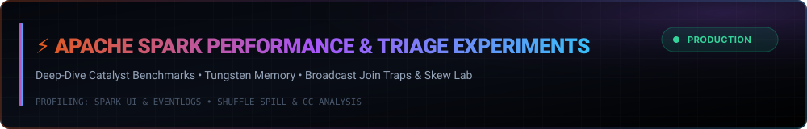
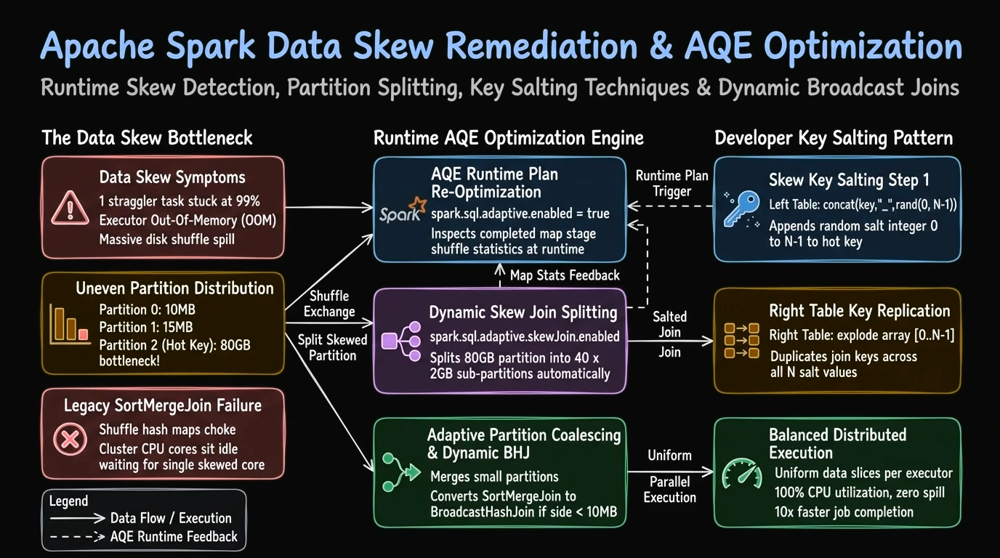
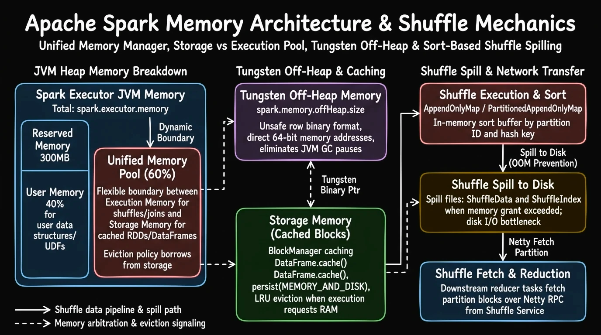

<p align="center">
  
</p>

# Apache Spark Performance Experiments & Tuning Lab

<p align="center">
  <a href="https://github.com/santoshjammi29/spark-experiments/actions"></a>
  <a href="https://spark.apache.org/"></a>
  <a href="https://www.python.org/"></a>
  <a href="LICENSE"></a>
  <a href="https://moderndataengineer.uk"></a>
</p>

## 🎯 Overview & Mission

This repository is the definitive hands-on experimental lab for mastering advanced Apache Spark performance tuning, execution internals, and cluster memory triage. Accompanying the popular **[Spark Performance Tuning Video Series](https://www.youtube.com/playlist?list=PLWAuYt0wgRcLCtWzUxNg4BjnYlCZNEVth)** on YouTube, this lab provides reproducible Jupyter notebooks, synthetic skew datasets, and live query plan diagnostics designed to bridge the gap between abstract Spark concepts and real-world production engineering.

---

## 🚀 Quickstart & Reproducible Lab Setup

Get the entire reproducible Spark experiment environment running locally in under 2 minutes:

```bash
# 1. Clone the repository
git clone https://github.com/santoshjammi29/spark-experiments.git
cd spark-experiments

# 2. Set up virtual environment
python3 -m venv .venv
source .venv/bin/activate

# 3. Install dependencies (PySpark, Jupyter, Pandas)
pip install -r requirements.txt

# 4. Launch Jupyter Lab / Notebooks
jupyter notebook

# 5. Run automated notebook integrity tests
python3 scripts/run_tests.py
```

---

## 🔬 Hands-On Performance Experiments & Video Catalog

| Concept             | YouTube Link                                            | Code                                                     |
|---------------------|---------------------------------------------------------|----------------------------------------------------------|
| Spark 30 Concepts           | [](https://youtu.be/z4Owc8RRApg) | |
| Spark Query Plans           | [](https://youtu.be/KnUXztKueMU) | [](spark/2_reading_query_plans.ipynb) |
| Spark DAGs           | [](https://youtu.be/O_45zAz1OGk) | [](spark/3_reading_query_DAGs.ipynb) |
| Spark Memory Management           | [](https://youtu.be/sXL1qgrPysg) |  |
| Spark Executor Tuning  | [](https://youtu.be/mA96gUESVZc) |  |
| Shuffle Partitions      | [](https://youtu.be/q1LtBU_ca20) |  |
| Data Partitioning        | [](https://youtu.be/fZndmQasykk) | [](spark/5_0_partitioning.ipynb) |
| Bucketing       | [](https://youtu.be/1kWl6d1yeKA) | [](spark/6_0_bucketing.ipynb) |
| Caching           | [](https://youtu.be/FujwRYkBwM4) | [](spark/4_caching.ipynb) |
| Data Skew                 | [](https://youtu.be/9Ss-_y7njKE) | [](spark/1_data_skew/) |
| Salting                 | [](https://youtu.be/rZGsc5y8AQk) | [](spark/1_data_skew/4_salting.ipynb) |
| AQE & Broadcast Joins                 | [](https://youtu.be/bRjVa7MgsBM) | [](spark/1_data_skew/3_solving_data_skew_aqe_broadcast.ipynb) |
| Dynamic Partition Pruning                 | [](https://youtu.be/s8Z8Gex7VFw) | [](spark/5_1_dynamic_partition_pruning.ipynb) |

---

## 🖼️ Master Whiteboard Architecture Blueprints

The repository incorporates publication-grade architectural whiteboard blueprints mirrored under [`assets/whiteboards/`](assets/whiteboards) and indexed with comprehensive multi-persona breakdowns, failure modes, and engine internals in [`docs/whiteboard_diagrams/README.md`](docs/whiteboard_diagrams/README.md).

- 🖼️ **[Master Whiteboard Blueprints Hub](docs/whiteboard_diagrams/handbook_whiteboard_blueprints.md)**: Complete whiteboard architecture blueprints with storage vs. compute, control vs. data planes, memory tiers, and failure modes.
- 📊 **[Spark Architecture & Tuning Cheatsheet](assets/whiteboards/catalyst_photon_engine.webp)**: High-resolution visual cheatsheet covering cluster topology, Catalyst compiler phases, and memory tiers.
- 🔀 **[Join Strategies Decision Matrix](assets/whiteboards/spark_join_decision_tree.webp)**: Visual flowchart and decision tree for distributed joins and broadcast thresholds.
- ⚡ **[Skew & Memory Spill Triage](assets/whiteboards/spark_memory_management_spill_diagram.webp)**: Step-by-step diagnostic workflow for data skew, spill to disk, and OOM triage.

### 📐 Visual Blueprints Showcase (2x2 Grid)

<table>
  <tr>
    <td width="50%" valign="top">
      <a href="docs/whiteboard_diagrams/README.md#spark-data-skew-aqe-optimization">
        
      </a>
      <br><strong>Apache Spark Data Skew Remediation & AQE Optimization</strong><br>
      <em>Synthetic skew benchmarks: Diagnosing stragglers, two-phase key salting, and AQE partition splitting.</em>
    </td>
    <td width="50%" valign="top">
      <a href="docs/whiteboard_diagrams/README.md#spark-memory-management-spill">
        
      </a>
      <br><strong>Apache Spark Memory Management & Shuffle Spilling Mechanics</strong><br>
      <em>Unified memory manager, execution vs storage borrowing, and Tungsten spill-to-disk triage runbooks.</em>
    </td>
  </tr>
  <tr>
    <td width="50%" valign="top">
      <a href="docs/whiteboard_diagrams/README.md#spark-shuffle-memory-execution">
        
      </a>
      <br><strong>Apache Spark Memory Architecture & Shuffle Mechanics</strong><br>
      <em>Shuffle block transfer, SortShuffleWriter, index and data files, and external shuffle service mechanics.</em>
    </td>
    <td width="50%" valign="top">
      <a href="docs/whiteboard_diagrams/README.md#spark-join-decision-tree">
        
      </a>
      <br><strong>Apache Spark Join Strategy Selection Decision Tree</strong><br>
      <em>Join strategy selection algorithm: Broadcast Hash Join vs Shuffle Hash Join vs Sort-Merge Join vs Cartesian.</em>
    </td>
  </tr>
  <tr>
    <td width="50%" valign="top">
      <a href="docs/whiteboard_diagrams/README.md#spark-catalyst-photon-engine">
        
      </a>
      <br><strong>Databricks Compute: Catalyst Optimizer, AQE & Photon</strong><br>
      <em>5-phase compiler: Unresolved AST, logical optimization, cost-based physical planning, and code generation.</em>
    </td>
    <td width="50%" valign="top">
      <a href="docs/whiteboard_diagrams/README.md#spark-aqe-dynamic-optimization">
        
      </a>
      <br><strong>Apache Spark Adaptive Query Execution (AQE) Architecture</strong><br>
      <em>Runtime re-optimization: Coalescing shuffle partitions, dynamic join strategy switching, and skew handling.</em>
    </td>
  </tr>
  <tr>
    <td width="50%" valign="top">
      <a href="docs/whiteboard_diagrams/README.md#photon-engine-vs-jvm">
        
      </a>
      <br><strong>Photon Native C++ Engine vs. Classic Spark JVM</strong><br>
      <em>SIMD vectorized hardware acceleration, off-heap columnar buffers, and eliminating JVM GC pause overhead.</em>
    </td>
    <td width="50%" valign="top">
      <a href="docs/whiteboard_diagrams/README.md#spark-broadcast-accumulators">
        
      </a>
      <br><strong>Spark Broadcast Variables vs. Accumulators Architecture</strong><br>
      <em>BitTorrent P2P broadcast distribution vs driver-aggregated task metrics and side-effect guarantees.</em>
    </td>
  </tr>
</table>

> 🔍 **Explore all 52 blueprints with 5-persona breakdowns, failure modes, and engine internals in [docs/whiteboard_diagrams/README.md](docs/whiteboard_diagrams/README.md)**.

---

## 🧠 Core Curriculum Concepts & Topics (135 Topics Covered)

> 💡 **Enterprise Knowledge Base Integration**: This repository implements **135 production topics** from the [Modern Data Engineering Systems Encyclopedia (921 Topics)](https://moderndataengineer.uk/concepts), grouped by **Relevant Functional Sections** and then by **Difficulty Level**. All sections are **collapsible and collapsed by default** for effortless navigation. Browse the full curriculum in [`topics/README.md`](topics/README.md).

### 📑 Topics Directory at a Glance

| Pillar / Module | Topic Count | Functional Sections Covered | Status |
|:---|:---:|:---|:---:|
| ⚡ **Apache Spark & Distributed Compute Engine** | **135** | Core Architecture & RDD/DataFrame Primitives, Catalyst Optimizer & Execution Plans, Partitioning, Shuffling & Skew Mitigation, and 3 more | ✅ Collapsible Deck |

<details>
<summary><b>⚡ Apache Spark & Distributed Compute Engine (135 Topics across 6 Sections)</b> — <i>Click to expand module</i></summary>

<details>
<summary>&nbsp;&nbsp;📂 <b>Section: Catalyst Optimizer & Execution Plans (24 Topics)</b></summary>

<details>
<summary>&nbsp;&nbsp;&nbsp;&nbsp;🟢 Easy: <b>🟢 Easy (Level 100) (2 Topics)</b></summary>

| # | Topic / Concept | Level | Architectural Definition & Core Principle |
|:---:|---|:---:|---|
| 1 | **Managed vs External Tables** | `🟢 Easy` | Catalog table definitions specifying whether Spark manages both the metadata and the physical storage data. |
| 2 | **Temp Views & Global Temp Views** | `🟢 Easy` | Session-scoped and cluster-scoped virtual tables that provide temporary SQL query interfaces over DataFrames without persisting physical data files to storage. |

</details>

<details>
<summary>&nbsp;&nbsp;&nbsp;&nbsp;🟡 Intermediate: <b>🟡 Intermediate (Level 200) (8 Topics)</b></summary>

| # | Topic / Concept | Level | Architectural Definition & Core Principle |
|:---:|---|:---:|---|
| 1 | **Adaptive Query Execution (AQE)** | `🟡 Intermediate` | An optimization framework that dynamically adjusts Spark physical execution plans during runtime based on intermediate stage statistics. |
| 2 | **Catalyst Optimizer** | `🟡 Intermediate` | The core query optimization engine powering Spark SQL and the DataFrame API. |
| 3 | **DAG & RDD Lineage** | `🟡 Intermediate` | The logical execution graph tracking all transformations applied to a dataset to enable fault-tolerance. |
| 4 | **DAG Scheduler** | `🟡 Intermediate` | The high-level scheduling layer in Apache Spark that converts a logical DAG of RDD transformations into a physical execution plan of stages. |
| 5 | **EXPLAIN Plan (Spark Query Plan)** | `🟡 Intermediate` | A Spark debugging tool that displays the logical and physical execution plan for a DataFrame or SQL query, enabling engineers to verify optimisations, diagnose performance issues, and understand data flow. |
| 6 | **Join Strategies** | `🟡 Intermediate` | The physical execution algorithms selected by the Catalyst optimizer for distributed table joins, including Broadcast Hash Join (BHJ), Sort-Merge Join (SMJ), and Shuffle Hash Join (SHJ). |
| 7 | **Shuffle Operations** | `🟡 Intermediate` | The distributed physical data redistribution process across cluster executor nodes triggered by wide transformations such as `groupBy()`, `join()`, `distinct()`, and `repartition()`. |
| 8 | **UDFs vs. Native Functions** | `🟡 Intermediate` | The architectural trade-offs between native Catalyst expressions and custom Python UDFs, highlighting serialization overhead, memory penalties, and whole-stage code generation boundaries. |

</details>

<details>
<summary>&nbsp;&nbsp;&nbsp;&nbsp;🔴 Advanced: <b>🔴 Advanced (Level 300) (8 Topics)</b></summary>

| # | Topic / Concept | Level | Architectural Definition & Core Principle |
|:---:|---|:---:|---|
| 1 | **BroadcastNestedLoopJoin Anti-Pattern** | `🔴 Advanced` | The most dangerous physical join operator in Apache Spark, executing an $O(M 	imes N)$ Cartesian product comparison when equi-join conditions are missing. |
| 2 | **Catalyst Optimizer — Analysis Phase** | `🔴 Advanced` | The first phase of Spark's Catalyst Optimizer where unresolved logical plans are validated against the catalog to produce a resolved logical plan. |
| 3 | **Catalyst Optimizer — Physical Planning** | `🔴 Advanced` | The phase of Spark's Catalyst Optimizer that selects the most efficient physical execution strategy from multiple candidate plans using a cost model. |
| 4 | **Photon Execution Engine** | `🔴 Advanced` | Databricks' native vectorised query execution engine written in C++, replacing Spark's JVM-based Whole-Stage CodeGen for SQL and DataFrame workloads to deliver significantly higher throughput. |
| 5 | **PySpark Actions vs Transformations: Lazy Evaluation and Driver OOM** | `🔴 Advanced` | The foundational execution boundary in Apache Spark separating lazily evaluated DAG construction (Transformations) from physical execution triggers (Actions), along with memory safety guardrails. |
| 6 | **Spark Partitioning vs. Bucketing Architecture** | `🔴 Advanced` | The two primary storage organization techniques in Apache Spark that govern physical directory layouts, file pruning, and shuffle elimination. |
| 7 | **Tungsten Engine** | `🔴 Advanced` | Spark's physical execution optimizer that manages memory directly using raw off-heap byte arrays. |
| 8 | **Whole-Stage Code Generation (Tungsten)** | `🔴 Advanced` | Collapsing an entire physical query execution stage of multiple operators into a single optimized Java bytecode loop. |

</details>

<details>
<summary>&nbsp;&nbsp;&nbsp;&nbsp;🟣 Architect: <b>🟣 Staff Architect (Level 400) (6 Topics)</b></summary>

| # | Topic / Concept | Level | Architectural Definition & Core Principle |
|:---:|---|:---:|---|
| 1 | **Adaptive Query Execution (AQE) Runtime Optimization** | `🟣 Architect` | Dynamic query re-optimization framework in Apache Spark inspecting physical shuffle statistics at stage boundaries to re-plan execution plans on the fly. |
| 2 | **AQE Query Stage Re-Optimization Boundaries** | `🟣 Architect` | The runtime execution boundaries in Apache Spark where completed shuffle stages materialize partition statistics, enabling the catalyst optimizer to dynamically alter downstream physical plans. |
| 3 | **Post-Shuffle Partition Coalescing** | `🟣 Architect` | An automated runtime optimization in Spark AQE that aggregates small contiguous shuffle partitions into larger logical partitions to minimize driver scheduling overhead. |
| 4 | **Spark Connect Architecture & Decoupled Python Drivers** | `🟣 Architect` | A decoupled client-server architecture in Apache Spark 3.4+ that transmits unresolved logical query plans via gRPC protocol buffers from a lightweight Python client to a remote Spark server. |
| 5 | **Spark DataFrame API: Catalyst Optimizer and Project Tungsten** | `🟣 Architect` | The high-level declarative query interface in Apache Spark that achieves superior throughput and memory efficiency over RDDs through automated Catalyst query planning and Tungsten byte-code generation. |
| 6 | **Spark Memory Management: Off-Heap, Storage vs Execution Dynamics** | `🟣 Architect` | The internal physical memory layout of a Spark JVM executor governed by UnifiedMemoryManager and Project Tungsten. |

</details>

</details>

<details>
<summary>&nbsp;&nbsp;📂 <b>Section: Memory Management & Tungsten Engine (26 Topics)</b></summary>

<details>
<summary>&nbsp;&nbsp;&nbsp;&nbsp;🟡 Intermediate: <b>🟡 Intermediate (Level 200) (5 Topics)</b></summary>

| # | Topic / Concept | Level | Architectural Definition & Core Principle |
|:---:|---|:---:|---|
| 1 | **Broadcast Variable** | `🟡 Intermediate` | A Spark mechanism to efficiently distribute a read-only value (e.g., a lookup table or configuration map) to every executor once, stored in executor memory for reuse across all tasks. |
| 2 | **Cache vs Persist Operations** | `🟡 Intermediate` | DataFrame operations used to store intermediate execution results in memory or disk to avoid recalculations. |
| 3 | **Reading the Spark UI** | `🟡 Intermediate` | The web-based performance monitoring and telemetry dashboard used to inspect execution plans, identify straggler tasks, detect memory spill, and profile shuffle I/O across Spark Jobs, Stages, and SQL DAGs. |
| 4 | **Shuffle Hash Join vs. Sort Merge Join** | `🟡 Intermediate` | The architectural trade-offs between sorting keys on disk (SMJ) versus building in-memory hash tables across partitions (SHJ). |
| 5 | **Storage Level: MEMORY_AND_DISK** | `🟡 Intermediate` | A Spark cache storage level that stores partitions in JVM heap memory and spills remaining partitions to local executor disk if memory is insufficient. |

</details>

<details>
<summary>&nbsp;&nbsp;&nbsp;&nbsp;🔴 Advanced: <b>🔴 Advanced (Level 300) (15 Topics)</b></summary>

| # | Topic / Concept | Level | Architectural Definition & Core Principle |
|:---:|---|:---:|---|
| 1 | **Executor Memory Overhead** | `🔴 Advanced` | The amount of non-heap off-JVM memory reserved per executor for native processes, Python workers, and JVM internal overhead, separate from spark.executor.memory. |
| 2 | **G1GC Garbage Collector in Spark** | `🔴 Advanced` | The Garbage-First (G1) GC is the recommended JVM garbage collector for Spark executors, offering predictable pause times and better heap region management than the older ParallelGC. |
| 3 | **G1GC Garbage Collector Tuning in Spark** | `🔴 Advanced` | Configuring the Garbage-First Garbage Collector (`-XX:+UseG1GC`) for low-pause heap reclamation in large Spark executors. |
| 4 | **Memory Management & Spill** | `🔴 Advanced` | The Spark Unified Memory architecture that dynamically shares RAM between Execution (shuffles/joins) and Storage (caching), spilling in-memory buffers to disk when executor memory limits are exceeded. |
| 5 | **Memory Spill to Disk** | `🔴 Advanced` | A performance degradation state where Spark runs out of executor RAM and writes execution buffers to disk. |
| 6 | **Off-Heap Memory** | `🔴 Advanced` | Memory allocated outside the JVM heap using native OS memory, bypassing garbage collection entirely and managed explicitly by Project Tungsten's memory manager. |
| 7 | **Shuffle Hash Join (SHJ)** | `🔴 Advanced` | A Spark join strategy that shuffles both tables by join key and builds an in-memory hash table from the smaller side of each partition to probe with the larger side. |
| 8 | **Small File Problem** | `🔴 Advanced` | A performance anti-pattern where a Delta/Parquet table accumulates thousands of tiny files, causing excessive file listing overhead, driver memory pressure during metadata operations, and poor read throughput. |
| 9 | **Spark Executor Memory Overhead Sizing** | `🔴 Advanced` | Allocating native off-heap memory via `spark.executor.memoryOverhead` for PyArrow, C++ libraries, and OS buffers. |
| 10 | **Spark Tungsten Off-Heap Memory Model** | `🔴 Advanced` | Project Tungsten's memory management system that allocates binary row representations directly in C-style off-heap memory using sun.misc.Unsafe. |
| 11 | **Spill to Disk** | `🔴 Advanced` | The mechanism by which Spark writes in-progress shuffle or sort buffers to executor local disk when execution memory is insufficient to hold all intermediate records. |
| 12 | **Stream-Stream Joins** | `🔴 Advanced` | A bidirectional stateful join between two continuous real-time data streams requiring event-time watermarking and time-interval constraints on both sides to bound in-memory state buffer growth. |
| 13 | **Tungsten Binary Row Format (UnsafeRow)** | `🔴 Advanced` | Apache Spark's off-heap binary row format that stores data as raw bytes using sun.misc.Unsafe, bypassing JVM object overhead and enabling cache-efficient processing. |
| 14 | **Watermarks & Late Data** | `🔴 Advanced` | A streaming state management mechanism (`withWatermark()`) that specifies the maximum allowable delay for incoming events, permitting Spark to evict expired state from memory. |
| 15 | **Whole-Stage Code Generation** | `🔴 Advanced` | A Project Tungsten optimisation that compiles an entire pipeline of Spark operators into a single Java function, eliminating virtual function dispatch overhead and enabling JIT optimisation. |

</details>

<details>
<summary>&nbsp;&nbsp;&nbsp;&nbsp;🟣 Architect: <b>🟣 Staff Architect (Level 400) (6 Topics)</b></summary>

| # | Topic / Concept | Level | Architectural Definition & Core Principle |
|:---:|---|:---:|---|
| 1 | **Driver OutOfMemory (OOM)** | `🟣 Architect` | A fatal Spark application failure where the driver JVM process exhausts its heap memory, typically caused by collecting large results, broadcasting oversized DataFrames, or accumulating large metadata. |
| 2 | **Executor OutOfMemory (OOM)** | `🟣 Architect` | A Spark task failure where an executor JVM process runs out of heap memory during task execution, typically caused by data skew, oversized joins, or insufficient shuffle partition count. |
| 3 | **Spark SQL Broadcast Joins & Key Salting for Data Skew** | `🟣 Architect` | Distributed query execution techniques in Apache Spark to eliminate shuffle bottlenecks during asymmetric joins and mitigate executor memory exhaustion caused by skewed join keys. |
| 4 | **Spark Unified Memory Manager** | `🟣 Architect` | The memory management subsystem introduced in Apache Spark that unifies execution and storage memory into a single shared pool with dynamic borrowing. |
| 5 | **The 5 S's of Apache Spark Performance** | `🟣 Architect` | The 5 S's of Spark is a diagnostic framework categorizing all distributed big data bottlenecks into Storage, Skew, Spill, Shuffle, and Serialization. |
| 6 | **Volcano Iterator vs. Vectorized Execution** | `🟣 Architect` | The Volcano Iterator model processes queries tuple-at-a-time via a pull-based next() interface, whereas Vectorized Execution processes batches of column vectors directly in CPU cache. |

</details>

</details>

<details>
<summary>&nbsp;&nbsp;📂 <b>Section: Partitioning, Shuffling & Skew Mitigation (25 Topics)</b></summary>

<details>
<summary>&nbsp;&nbsp;&nbsp;&nbsp;🟢 Easy: <b>🟢 Easy (Level 100) (2 Topics)</b></summary>

| # | Topic / Concept | Level | Architectural Definition & Core Principle |
|:---:|---|:---:|---|
| 1 | **Narrow Transformation** | `🟢 Easy` | A Spark transformation where each output partition depends on exactly one input partition, requiring no data movement across the network. |
| 2 | **Wide Transformation** | `🟢 Easy` | A Spark transformation where each output partition may depend on multiple input partitions from different executors, requiring a full shuffle of data across the network. |

</details>

<details>
<summary>&nbsp;&nbsp;&nbsp;&nbsp;🟡 Intermediate: <b>🟡 Intermediate (Level 200) (6 Topics)</b></summary>

| # | Topic / Concept | Level | Architectural Definition & Core Principle |
|:---:|---|:---:|---|
| 1 | **coalesce() vs repartition()** | `🟡 Intermediate` | Two Spark functions for changing partition count: coalesce() reduces partitions without a full shuffle by merging local partitions, while repartition() performs a full shuffle to evenly redistribute data across any number of partitions. |
| 2 | **Dynamic Partition Overwrite** | `🟡 Intermediate` | A Spark write mode that overwrites only the partitions present in the incoming DataFrame, leaving partitions not touched by the current write intact. |
| 3 | **Partition Pruning** | `🟡 Intermediate` | A Spark read optimisation that skips entire partition directories in storage when a query's WHERE clause exactly matches or narrows the partitioning key, avoiding unnecessary I/O. |
| 4 | **Spark AQE Dynamic Shuffle Partition Coalescing** | `🟡 Intermediate` | A runtime optimization in Apache Spark 3.0+ that inspects post-shuffle partition sizes and automatically combines undersized partitions into target-sized task bundles. |
| 5 | **Spark Broadcast Hash Join (BHJ)** | `🟡 Intermediate` | A distributed join strategy in Apache Spark that distributes an entire small DataFrame to all executor nodes to eliminate costly shuffle operations. |
| 6 | **Stage Boundary** | `🟡 Intermediate` | A stage boundary in Spark marks the point where a wide transformation (shuffle) separates two stages, requiring all tasks in the upstream stage to complete before the downstream stage begins. |

</details>

<details>
<summary>&nbsp;&nbsp;&nbsp;&nbsp;🔴 Advanced: <b>🔴 Advanced (Level 300) (12 Topics)</b></summary>

| # | Topic / Concept | Level | Architectural Definition & Core Principle |
|:---:|---|:---:|---|
| 1 | **AQE Dynamic Join Strategy Switching** | `🔴 Advanced` | A runtime optimization in Adaptive Query Execution that converts planned SortMergeJoins into BroadcastHashJoins based on post-shuffle partition size statistics. |
| 2 | **AQE Dynamic Skew Join Splitting** | `🔴 Advanced` | An AQE optimization that automatically identifies skewed shuffle partitions at runtime and splits them into smaller sub-partitions to balance executor workload. |
| 3 | **AQE Shuffle Partition Coalescing** | `🔴 Advanced` | An Adaptive Query Execution feature that merges small post-shuffle partitions at runtime into larger ones, eliminating the small-file and task-overhead problem from over-partitioning. |
| 4 | **Bucket Join** | `🔴 Advanced` | A Spark join optimisation that eliminates shuffle entirely by pre-bucketing both tables on the join key with the same number of buckets, co-locating matching keys on the same partitions. |
| 5 | **Data Skew & Salt Keys** | `🔴 Advanced` | A performance bottleneck where a few data partitions hold disproportionately more records, resolved by adding random salt keys. |
| 6 | **Data Skew: Detection & Mitigation** | `🔴 Advanced` | The process of diagnosing uneven record distributions across executor partitions using Spark UI percentiles, resolved via Adaptive Query Execution (AQE) skew join splitting or two-phase key salting. |
| 7 | **External Shuffle Service** | `🔴 Advanced` | A long-running service on each worker node that serves shuffle blocks independently of executor JVM processes, allowing executors to be removed during dynamic scaling without losing shuffle data. |
| 8 | **Pandas UDF — GROUPED_MAP Type** | `🔴 Advanced` | A PySpark UDF pattern that receives an entire partition group (keyed by groupBy columns) as a Pandas DataFrame, applies arbitrary Python/Pandas logic, and returns a Pandas DataFrame — enabling per-group custom transformations. |
| 9 | **Sort Merge Join (SMJ)** | `🔴 Advanced` | Spark's default join strategy for large-to-large table joins, where both datasets are shuffled by join key, sorted, and merged partition-by-partition on executor cores. |
| 10 | **Spark Data Skew & Salting Technique** | `🔴 Advanced` | A distributed data engineering pattern that redistributes skewed join or aggregation keys across multiple executor tasks by appending random numerical salt prefixes. |
| 11 | **Spark Join Skew Remediation via Key Salting** | `🔴 Advanced` | Key Salting is a distributed optimization technique where a pseudo-random integer suffix is appended to skewed join keys to distribute data uniformly across shuffle partitions. |
| 12 | **Task Duration Skew Detection** | `🔴 Advanced` | Using Spark Web UI task duration percentiles (75th vs Max) to diagnose unbalanced partition distributions. |

</details>

<details>
<summary>&nbsp;&nbsp;&nbsp;&nbsp;🟣 Architect: <b>🟣 Staff Architect (Level 400) (5 Topics)</b></summary>

| # | Topic / Concept | Level | Architectural Definition & Core Principle |
|:---:|---|:---:|---|
| 1 | **Salted Join (Skew Mitigation)** | `🟣 Architect` | A technique to handle data skew in Spark joins by appending a random integer ('salt') to skewed keys, exploding the smaller table to match, thereby distributing hot partitions across multiple executors. |
| 2 | **Shuffle Fetch Failed** | `🟣 Architect` | A Spark task failure that occurs when a downstream task cannot retrieve shuffle data from an upstream executor, typically caused by executor loss, OOM, or network partition. |
| 3 | **Skewed Shuffle Partition Splitting** | `🟣 Architect` | A dynamic AQE mechanism that identifies disproportionately large shuffle partitions and divides them into parallel sub-tasks while duplicating opposing join data. |
| 4 | **Spark Data Skew Remediation: Salting & Isolated Broadcast Patterns** | `🟣 Architect` | Algorithmic architectural strategies to balance severely uneven data distributions across Spark cluster worker cores during shuffle-intensive joins. |
| 5 | **Zombie Worker** | `🟣 Architect` | A Databricks/Spark executor node that has been declared dead by the driver (due to heartbeat timeout or network partition) but continues running tasks in isolation, causing double-execution and potential data corruption. |

</details>

</details>

<details>
<summary>&nbsp;&nbsp;📂 <b>Section: Join Strategies & Broadcast Mechanics (2 Topics)</b></summary>

<details>
<summary>&nbsp;&nbsp;&nbsp;&nbsp;🟡 Intermediate: <b>🟡 Intermediate (Level 200) (2 Topics)</b></summary>

| # | Topic / Concept | Level | Architectural Definition & Core Principle |
|:---:|---|:---:|---|
| 1 | **Broadcast Join Auto-Threshold Tuning** | `🟡 Intermediate` | Configuring `spark.sql.autoBroadcastJoinThreshold` to safely broadcast lookup tables without driver OutOfMemoryError. |
| 2 | **Semi Join & Anti Join** | `🟡 Intermediate` | Spark join types that filter the left table based on existence (semi) or non-existence (anti) of matching rows in the right table, without including right-side columns in the output. |

</details>

</details>

<details>
<summary>&nbsp;&nbsp;📂 <b>Section: Streaming, Vectorization & UDFs (8 Topics)</b></summary>

<details>
<summary>&nbsp;&nbsp;&nbsp;&nbsp;🟡 Intermediate: <b>🟡 Intermediate (Level 200) (5 Topics)</b></summary>

| # | Topic / Concept | Level | Architectural Definition & Core Principle |
|:---:|---|:---:|---|
| 1 | **foreachBatch Pattern** | `🟡 Intermediate` | A Structured Streaming sink API method that processes each micro-batch as a static DataFrame, enabling custom multi-table writes, MERGE upserts, and external API integrations. |
| 2 | **PySpark Pandas API on Spark (formerly Koalas)** | `🟡 Intermediate` | A PySpark API that implements the pandas DataFrame interface on top of distributed Spark DataFrames, allowing pandas code to scale across a cluster with minimal code changes. |
| 3 | **PySpark Vectorized Pandas UDF Architecture** | `🟡 Intermediate` | Using Apache Arrow record batches to pass columnar data between the JVM and Python worker processes with high efficiency. |
| 4 | **Stream-Static Joins** | `🟡 Intermediate` | A stateful stream enrichment pattern that joins real-time streaming DataFrames with static reference or dimensional tables without requiring unbounded streaming state retention. |
| 5 | **Structured Streaming Fundamentals** | `🟡 Intermediate` | The scalable, fault-tolerant stream processing engine in Apache Spark that models streaming data as append-only unbounded tables, leveraging Delta Lake sources and sinks with exactly-once guarantees. |

</details>

<details>
<summary>&nbsp;&nbsp;&nbsp;&nbsp;🔴 Advanced: <b>🔴 Advanced (Level 300) (2 Topics)</b></summary>

| # | Topic / Concept | Level | Architectural Definition & Core Principle |
|:---:|---|:---:|---|
| 1 | **Pandas UDF — SCALAR Type** | `🔴 Advanced` | A vectorised PySpark UDF that receives a batch of column values as a Pandas Series, applies a Python function, and returns a Pandas Series — using Apache Arrow for efficient zero-copy data transfer. |
| 2 | **Structured Streaming Watermark** | `🔴 Advanced` | A Spark Structured Streaming mechanism that defines how late an event can arrive and still be included in a windowed aggregation, enabling Spark to clean up state for windows that are no longer expected to receive late data. |

</details>

<details>
<summary>&nbsp;&nbsp;&nbsp;&nbsp;🟣 Architect: <b>🟣 Staff Architect (Level 400) (1 Topics)</b></summary>

| # | Topic / Concept | Level | Architectural Definition & Core Principle |
|:---:|---|:---:|---|
| 1 | **Structured Streaming Checkpointing & Exactly-Once Semantics** | `🟣 Architect` | End-to-end fault tolerance mechanism guaranteeing each incoming stream event is processed and written to sink storage exactly once, even through cluster crashes. |

</details>

</details>

<details>
<summary>&nbsp;&nbsp;📂 <b>Section: Core Architecture & RDD/DataFrame Primitives (50 Topics)</b></summary>

<details>
<summary>&nbsp;&nbsp;&nbsp;&nbsp;🟢 Easy: <b>🟢 Easy (Level 100) (5 Topics)</b></summary>

| # | Topic / Concept | Level | Architectural Definition & Core Principle |
|:---:|---|:---:|---|
| 1 | **Common Table Expression (CTE) in Spark SQL** | `🟢 Easy` | A named temporary result set defined within a WITH clause in Spark SQL that can be referenced multiple times in the same query, improving readability and enabling recursive queries. |
| 2 | **DataFrame** | `🟢 Easy` | A distributed collection of data organized into named columns, equivalent to a table in a relational database. |
| 3 | **PySpark Try-Cast Graceful Degradation** | `🟢 Easy` | A fault-tolerant casting function returning NULL instead of terminating the Spark job when parsing corrupted data strings. |
| 4 | **Resilient Distributed Dataset (RDD)** | `🟢 Easy` | Spark's core abstraction representing a read-only, partitioned, fault-tolerant collection of elements. |
| 5 | **SparkSession** | `🟢 Easy` | The unified entry point for programming Apache Spark applications using DataFrames and SQL. |

</details>

<details>
<summary>&nbsp;&nbsp;&nbsp;&nbsp;🟡 Intermediate: <b>🟡 Intermediate (Level 200) (26 Topics)</b></summary>

| # | Topic / Concept | Level | Architectural Definition & Core Principle |
|:---:|---|:---:|---|
| 1 | **Accumulator** | `🟡 Intermediate` | A Spark shared variable that allows tasks running on executors to additively update a counter or collection, which the driver can then read — used for diagnostics and monitoring. |
| 2 | **Apache Avro Format in Spark** | `🟡 Intermediate` | A row-oriented binary serialisation format used in Kafka/streaming pipelines and schema-registry-integrated workflows, supported in Spark via the spark-avro library. |
| 3 | **Complex Types: ARRAY, STRUCT, MAP** | `🟡 Intermediate` | Composite Spark SQL data types (ARRAY, STRUCT, MAP) representing hierarchical and nested data schemas, queried using dot-notation, array indexing, and higher-order functions. |
| 4 | **CTEs, PIVOT & Subqueries** | `🟡 Intermediate` | Advanced SQL query composition patterns—including Common Table Expressions, PIVOT aggregations, and subqueries—used to structure readable, modular, and optimized multi-step analytical transformations. |
| 5 | **Databricks Cluster Policies** | `🟡 Intermediate` | Databricks governance constructs that define JSON-based rules restricting or fixing cluster configuration parameters, enforced when users create new clusters in a workspace. |
| 6 | **Databricks Instance Pools** | `🟡 Intermediate` | A Databricks feature that maintains a pool of pre-provisioned, idle VM instances that clusters can attach to immediately, dramatically reducing cluster start time from minutes to seconds. |
| 7 | **Databricks Secrets** | `🟡 Intermediate` | A Databricks-managed key-value secret store that securely injects sensitive values (API keys, connection strings, passwords) into notebooks and job runs without exposing them as plaintext. |
| 8 | **Databricks Serverless Compute** | `🟡 Intermediate` | A Databricks compute model where Databricks manages the cluster lifecycle entirely — provisioning, scaling, and terminating compute resources instantly — with per-second DBU billing and zero cluster configuration. |
| 9 | **Delta Lake Schema Enforcement** | `🟡 Intermediate` | Delta Lake's default behaviour that rejects writes where the incoming DataFrame schema does not match the table's registered schema, preventing silent data corruption from schema drift. |
| 10 | **Delta Lake Schema Evolution** | `🟡 Intermediate` | Delta Lake's ability to automatically update a table's schema when new columns are added to an incoming DataFrame, without requiring manual schema changes or failing the write. |
| 11 | **Delta Lake Shallow Clone vs Deep Clone** | `🟡 Intermediate` | Two Delta Lake cloning strategies: shallow clone creates a new table pointing to the original's data files without copying them, while deep clone physically copies all data and log files to a new location. |
| 12 | **Delta Lake Time Travel** | `🟡 Intermediate` | Delta Lake's ability to query or restore a table to any previous version or timestamp by replaying the transaction log to reconstruct the historical table state. |
| 13 | **Higher-Order Functions** | `🟡 Intermediate` | Built-in Spark SQL functions (`transform`, `filter`, `exists`, `aggregate`) that manipulate nested arrays inline using anonymous lambda expressions without requiring expensive `explode()` operations. |
| 14 | **Lazy Evaluation** | `🟡 Intermediate` | An execution strategy where Spark delays query executions until an action is explicitly requested. |
| 15 | **Output Modes** | `🟡 Intermediate` | The streaming sink write configurations defining whether only newly processed rows are written (Append), the entire updated aggregation table is rewritten (Complete), or modified rows are updated in-place (Update). |
| 16 | **Parquet Columnar Storage** | `🟡 Intermediate` | An Apache Parquet file format that stores data column-by-column rather than row-by-row, enabling highly efficient compression and selective column reads for analytical workloads. |
| 17 | **Photon Engine (General)** | `🟡 Intermediate` | A native, vectorized query engine written in C++ that accelerates execution speeds of Spark SQL and DataFrame workloads. |
| 18 | **Predicate Pushdown** | `🟡 Intermediate` | Optimization technique that applies filter conditions early in query execution to reduce data movement and storage I/O before processing begins. |
| 19 | **RDD Lineage Graph** | `🟡 Intermediate` | The directed acyclic graph of transformations recorded for an RDD that allows Spark to reconstruct lost partitions by replaying only the transformations needed, rather than storing full data copies. |
| 20 | **Spark Connect (General)** | `🟡 Intermediate` | A client-server gRPC architecture that decouples the Spark driver from local client applications and developer IDEs. |
| 21 | **Spark Window Function** | `🟡 Intermediate` | A Spark SQL operation that performs calculations across a set of rows logically related to the current row (a 'window'), without collapsing the result into a single aggregate row. |
| 22 | **StructType & Explicit Schema** | `🟡 Intermediate` | The programmatic way to define the schema of a Spark DataFrame using StructType and StructField objects, avoiding the cost and risks of automatic schema inference from data. |
| 23 | **Table Constraints & Generated Columns** | `🟡 Intermediate` | Declarative relational integrity rules—including CHECK constraints, NOT NULL requirements, and computed generated columns—enforced by Delta Lake at write time to guarantee table quality. |
| 24 | **Task Scheduler** | `🟡 Intermediate` | The low-level component in Apache Spark responsible for assigning individual tasks to executor cores and handling task retries and speculative execution. |
| 25 | **VARIANT Type** | `🟡 Intermediate` | A native binary data type in Databricks and Spark designed to efficiently store semi-structured JSON data with sub-column shredding, indexing, and high-performance query execution. |
| 26 | **Windowed Aggregations** | `🟡 Intermediate` | Time-based streaming aggregations computed over fixed non-overlapping intervals (tumbling windows) or overlapping periodic intervals (sliding windows) bounded by event-time watermarks. |

</details>

<details>
<summary>&nbsp;&nbsp;&nbsp;&nbsp;🔴 Advanced: <b>🔴 Advanced (Level 300) (15 Topics)</b></summary>

| # | Topic / Concept | Level | Architectural Definition & Core Principle |
|:---:|---|:---:|---|
| 1 | **Databricks Auto Loader** | `🔴 Advanced` | A Databricks-native structured streaming source that incrementally ingests new files from cloud storage (S3/ADLS/GCS) as they arrive, using directory listing or file notification events to detect new files efficiently at scale. |
| 2 | **Delta Lake Change Data Feed (CDF)** | `🔴 Advanced` | A Delta Lake feature that records row-level change events (INSERT, UPDATE_PREIMAGE, UPDATE_POSTIMAGE, DELETE) in a special column, enabling downstream systems to consume only changed rows. |
| 3 | **Delta Lake Data Skipping** | `🔴 Advanced` | A Delta Lake read optimisation that uses per-file min/max column statistics stored in the transaction log to skip Parquet files entirely when their value ranges cannot contain query filter values. |
| 4 | **Delta Lake MERGE INTO (Upsert)** | `🔴 Advanced` | A Delta Lake SQL command that performs an atomic upsert — updating matched rows and inserting unmatched rows — in a single scan of both the target and source tables. |
| 5 | **Delta Lake OPTIMIZE with Z-Ordering** | `🔴 Advanced` | A Delta Lake maintenance operation that compacts small Parquet files (bin-packing) and optionally co-locates related data using Z-order multi-dimensional clustering to accelerate query data skipping. |
| 6 | **Delta Lake VACUUM** | `🔴 Advanced` | A Delta Lake maintenance command that physically deletes Parquet data files that are no longer referenced by any table version within the retention window. |
| 7 | **Delta Live Tables (DLT) (General)** | `🔴 Advanced` | A declarative SQL and Python framework for building, testing, and monitoring reliable batch and streaming data pipelines. |
| 8 | **Delta Log (_delta_log) Structure** | `🔴 Advanced` | The transaction log directory of a Delta table that records every change as JSON commit files, with periodic Parquet checkpoint files for efficient log replay. |
| 9 | **Dynamic Resource Allocation** | `🔴 Advanced` | A Spark feature that automatically scales executor count up and down based on workload demand, adding executors during high parallelism needs and releasing idle executors to the cluster manager. |
| 10 | **Executor Heartbeat Timeout** | `🔴 Advanced` | A Spark executor failure condition where the driver stops receiving heartbeat signals from an executor within the configured timeout window, causing the driver to declare the executor dead and reschedule its tasks. |
| 11 | **MERGE INTO & Upsert Patterns** | `🔴 Advanced` | The atomic `MERGE INTO` SQL operation used to coordinate simultaneous INSERT, UPDATE, and DELETE actions between source and target Delta tables in a single ACID transaction. |
| 12 | **Py4J Gateway** | `🔴 Advanced` | The bridge technology used by PySpark to enable Python processes to communicate with the JVM-based Spark driver, translating Python API calls into JVM method invocations over a local socket. |
| 13 | **Speculative Execution** | `🔴 Advanced` | A Spark fault-tolerance feature that launches a duplicate copy of a slow (straggler) task on another executor, using whichever copy finishes first and killing the other. |
| 14 | **Structured Streaming Checkpoint** | `🔴 Advanced` | A directory on durable storage where Spark Structured Streaming records the state of a streaming query — including offsets consumed and micro-batch progress — enabling recovery after failures without reprocessing. |
| 15 | **Unity Catalog (General)** | `🔴 Advanced` | A unified governance and catalog system for files, tables, dashboards, and notebooks across Databricks workspaces. |

</details>

<details>
<summary>&nbsp;&nbsp;&nbsp;&nbsp;🟣 Architect: <b>🟣 Staff Architect (Level 400) (4 Topics)</b></summary>

| # | Topic / Concept | Level | Architectural Definition & Core Principle |
|:---:|---|:---:|---|
| 1 | **Databricks Photon Native C++ Engine** | `🟣 Architect` | A ground-up rewrite of Apache Spark's execution engine in native C++, utilizing SIMD vectorized instruction sets to accelerate SQL and DataFrame operations. |
| 2 | **Databricks Photon Vectorized Execution Engine** | `🟣 Architect` | A native, high-performance vectorized query engine written in C++ designed to accelerate modern lakehouse SQL and DataFrame workloads. |
| 3 | **Delta Lake Liquid Clustering** | `🟣 Architect` | A next-generation Delta Lake table layout feature that replaces partitioning and Z-Ordering with dynamic, incremental clustering that continuously optimises data layout without full rewrites. |
| 4 | **RocksDB State Store in Structured Streaming** | `🟣 Architect` | An embedded, disk-backed LSM-tree state store provider engineered to manage multi-gigabyte or multi-billion-key stateful streaming pipelines. |

</details>

</details>

</details>

## 🌐 Ecosystem Interlinking & Sister Repositories

The Modern Data Engineering Lakehouse Ecosystem is an integrated suite of 14 production-grade, specialized repositories anchored by the **[Modern Data Engineer Platform (`moderndataengineer.uk`)](https://github.com/santoshjammi29/moderndataengineer)**. Use this cross-reference matrix to navigate directly between complementary implementations across our repositories:

| Repository | Focus & Domain | Tightly Coupled Cross-Reference & Integration Points |
| :--- | :--- | :--- |
| **[The PySpark Handbook](https://github.com/santoshjammi29/pyspark-handbook)** | 105 PySpark Production Code Recipes | • **Companion Code Drills**: 105 executable PySpark recipes for AQE, Tungsten memory, and Arrow UDFs.<br>• **Shuffle Tuning**: Code-level salting implementations validating the benchmarks in this repo. |
| **[The Databricks Handbook](https://github.com/santoshjammi29/databricks-handbook)** | 105 Databricks Production Recipes & Unity Catalog | • **Databricks Runtime & Photon**: Executing these performance benchmarks on Serverless DBSQL and Photon compute clusters.<br>• **Delta Lake Optimization**: Liquid Clustering and Deletion Vectors benchmarks. |
| **[Azure Databricks Blueprints](https://github.com/santoshjammi29/azure-databricks-project-blueprints)** | 3 Enterprise Reference Architectures | • **Real-World Workloads**: Applying these skew salting and memory triage runbooks to large retail fact joins and streaming fraud detection.<br>• **Production Deployment**: Packaging benchmark suites with Databricks Asset Bundles (DABs). |
| **[Banking Risk Lakehouse](https://github.com/santoshjammi29/enterprise-banking-risk-alm-lakehouse)** | Regulated Financial Lakehouse (BCBS 239 & IFRS 9) | • **Vectorized Simulation**: Benchmarking PyArrow Pandas UDF cash flow calculations under extreme memory pressure.<br>• **Audit Reconciliations**: High-volume financial ledger joins without shuffle spills. |
| **[DataOps & CI/CD Handbook](https://github.com/santoshjammi29/dataops-cicd-handbook)** | GitOps, DABs, Airflow & Platform Engineering | • **Automated Performance Testing**: Incorporating Spark execution plan regression testing into CI/CD pipelines.<br>• **Runbook Automation**: Emergency triage runbooks for Executor OOM (Exit code 137) and Driver OOM. |
| **[The SQL Handbook](https://github.com/santoshjammi29/sql-handbook)** | Relational Query Engines, MPP & Concurrency | • **MPP vs Spark Execution**: Comparing Spark Sort-Merge Joins with SQL Server Hash Match and MPP distributed queries.<br>• **Execution Plan Reading**: Translating Spark EXPLAIN plans to relational query execution plans. |
| **[The dbt Handbook](https://github.com/santoshjammi29/dbt-handbook)** | Analytics Engineering, dbt Mesh & Contracts | • **dbt Performance on Spark**: Optimizing incremental dbt models running on Apache Spark and Databricks SQL.<br>• **Partition Pruning**: Aligning dbt models with Spark partition schemes to eliminate full table scans. |
| **[Streaming Handbook](https://github.com/santoshjammi29/streaming-handbook)** | Kafka KRaft, Apache Flink & Event Architecture | • **Structured Streaming Tuning**: Tuning RocksDB state store memory, checkpoint frequencies, and watermark lateness.<br>• **Micro-batch Profiling**: Spark UI metrics for streaming trigger execution durations. |
| **[System Design Handbook](https://github.com/santoshjammi29/data-system-design-handbook)** | Distributed Storage, Table Formats & BCDR | • **Storage Format Benchmarks**: Parquet vs ORC vs Avro serialization performance and compression ratios.<br>• **Table Formats**: Delta Lake vs Apache Iceberg read and write throughput comparisons. |
| **[Azure Cheat Sheet](https://github.com/santoshjammi29/azure-cheat-sheet)** | Fabric OneLake, Synapse & Azure Infrastructure | • **Fabric Spark Tuning**: Capacity Unit (CU) smoothing, executor sizing, and V-Order Parquet write optimization.<br>• **Azure VMs**: Selecting compute-optimized (F-series) vs memory-optimized (E-series) VMs for Spark. |
| **[Interview Handbook](https://github.com/santoshjammi29/data-engineering-interview-handbook)** | Architectural Defense Playbooks & Concepts | • **100 Spark Data Issues Defense**: Playbook 08 (100 Spark Data Issues & Corruptions) with complete solutions.<br>• **Pillar 01 & 11**: Spark 3.5 engine internals, Catalyst compiler, and PyArrow IPC memory models. |
| **[The Security Handbook](https://github.com/santoshjammi29/security-handbook)** | Enterprise Cloud Security, Zero Trust & Lakehouse Governance | • **Zero Trust Lakehouse Perimeter**: Private endpoints, NSGs, and Azure Key Vault envelope encryption.<br>• **Workload Identity Federation**: Keyless GitHub Actions OIDC and Azure Managed Identities. |
| **[Modern Data Engineer Hub](https://github.com/santoshjammi29/moderndataengineer)** | Central Edge Presentation Platform | • **Interactive Whiteboard Viewer**: Pan, zoom, and inspect all 52 blueprints at [moderndataengineer.uk/whiteboards](https://moderndataengineer.uk/whiteboards).<br>• **Synthetic Skew & Spill Lab**: Interactive web simulator at [moderndataengineer.uk/spark-lab](https://moderndataengineer.uk/spark-lab). |

---

## Contact

- [LinkedIn](https://www.linkedin.com/in/afaque-ahmad-5a5847129/)
- [YouTube](https://www.youtube.com/@afaqueahmad7117)

---

## 🗺️ Interactive Curriculum Roadmap & Contributing

- **[Interactive Roadmap & Checkbox Tracker](docs/ROADMAP.md)**: Track your personal progress across all 4 Mastery Tiers (`Level 100` to `Level 400`).
- **[Curriculum Taxonomy & Standards](docs/TAXONOMY.md)**: Canonical controlled vocabulary, pillar mappings, and evidence standards.
- **[Contributing Guidelines](CONTRIBUTING.md)**: Authoring standards enforcing the Code-Test-Doc Triad and Anti-Pattern comparisons.
- **[Live Platform Hub](https://moderndataengineer.uk)**: Access the full 11,280+ record search engine, mindmaps, and vector PDF downloads.
