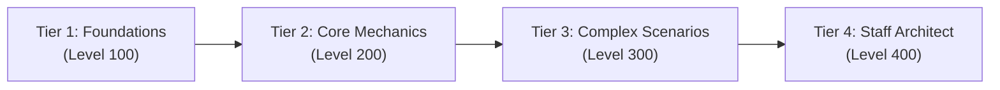

# 🗺️ Spark Experiments — Interactive Curriculum Roadmap

> **Interactive Checkbox Study Tracker & Mastery Progression**  
> **Canonical Repository**: [santoshjammi29/spark-experiments](https://github.com/santoshjammi29/spark-experiments) | **Ecosystem**: [moderndataengineer.uk](https://moderndataengineer.uk)  
> **Total Exercises & Drills**: `11` | **Primary Pillar**: `Apache Spark & Distributed Compute`

---

## How to Use This Roadmap

1. **Fork this repository** to your personal GitHub account.
2. Work through the modules in sequence or target specific architectural topics.
3. Check off boxes (`- [x]`) as you complete each exercise, drill, or notebook.
4. Commit and push your progress to your personal branch to track your career journey!

```
Progress: [ ] 0 / 11 Completed (0.0%)
```

---

## Curriculum Structure: The 4 Mastery Tiers



### 🟡 Tier 2: Core Mechanics & Implementation (Level 200)
> Production pipeline patterns, schema validation, standard transformations, and unit tests.

- [ ] `spark-experiments-curriculum-topics` — [Topics Directory: Spark Experiments](topics/README.md) `Level 200`

### 🟠 Tier 3: Complex Scenarios, Edge Cases & Performance (Level 300)
> Performance tuning, partition skew, memory triage runbooks, and failure recovery.

- [ ] `spark-experiments-1_generate_skewed_data` — [Generate Skewed Data](spark/1_data_skew/1_generate_skewed_data.ipynb) `Level 300`
- [ ] `spark-experiments-2_skew_dataset_simulation` — [Skew Dataset Simulation](spark/1_data_skew/2_skew_dataset_simulation.ipynb) `Level 300`
- [ ] `spark-experiments-3_solving_data_skew_aqe_broadcast` — [Solving Data Skew Aqe Broadcast](spark/1_data_skew/3_solving_data_skew_aqe_broadcast.ipynb) `Level 300`
- [ ] `spark-experiments-4_salting` — [Salting](spark/1_data_skew/4_salting.ipynb) `Level 300`
- [ ] `spark-experiments-2_reading_query_plans` — [Reading Query Plans](spark/2_reading_query_plans.ipynb) `Level 300`
- [ ] `spark-experiments-3_reading_query_DAGs` — [Reading Query Dags](spark/3_reading_query_DAGs.ipynb) `Level 300`
- [ ] `spark-experiments-4_caching` — [Caching](spark/4_caching.ipynb) `Level 300`
- [ ] `spark-experiments-5_0_partitioning` — [0 Partitioning](spark/5_0_partitioning.ipynb) `Level 300`
- [ ] `spark-experiments-5_1_dynamic_partition_pruning` — [1 Dynamic Partition Pruning](spark/5_1_dynamic_partition_pruning.ipynb) `Level 300`
- [ ] `spark-experiments-6_0_bucketing` — [0 Bucketing](spark/6_0_bucketing.ipynb) `Level 300`

---

## Suggested Study Schedules

| Schedule | Pace | Target Audience | Focus |
|---|---|---|---|
| **4-Week Sprint** | 5-6 drills / day | Interview Prep / Fast Track | Focus on Tier 2 & Tier 3 core drills |
| **8-Week Deep-Dive** | 2-3 drills / day | Full Technical Mastery | Complete all 11 exercises + tests |
| **12-Week Staff Track** | 1-2 drills / day | Architect & Tech Lead | Deep dive into Tier 3 & Tier 4 blueprints |

---

## Sister Repositories & Ecosystem Roadmaps

Explore interactive roadmaps across all 14 pillars of the lakehouse ecosystem:
- [Modern Data Engineer Central Hub](https://moderndataengineer.uk)
- [Databricks Handbook](https://github.com/santoshjammi29/databricks-handbook)
- [PySpark Handbook](https://github.com/santoshjammi29/pyspark-handbook)
- [SQL Handbook](https://github.com/santoshjammi29/sql-handbook)
- [dbt Handbook](https://github.com/santoshjammi29/dbt-handbook)
- [Streaming Handbook](https://github.com/santoshjammi29/streaming-handbook)
- [DataOps & CI/CD Handbook](https://github.com/santoshjammi29/dataops-cicd-handbook)
- [System Design Handbook](https://github.com/santoshjammi29/data-system-design-handbook)
- [Interview Handbook](https://github.com/santoshjammi29/data-engineering-interview-handbook)
- [Security Handbook](https://github.com/santoshjammi29/security-handbook)
